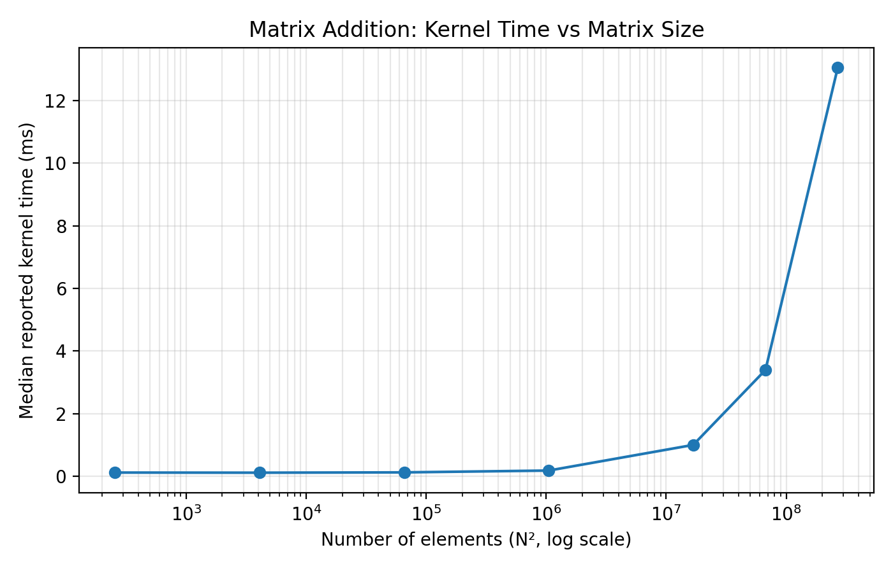
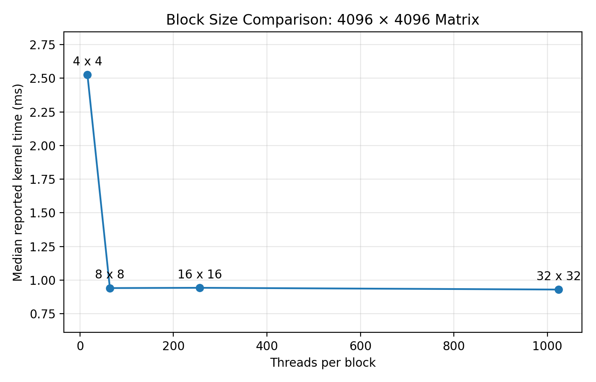
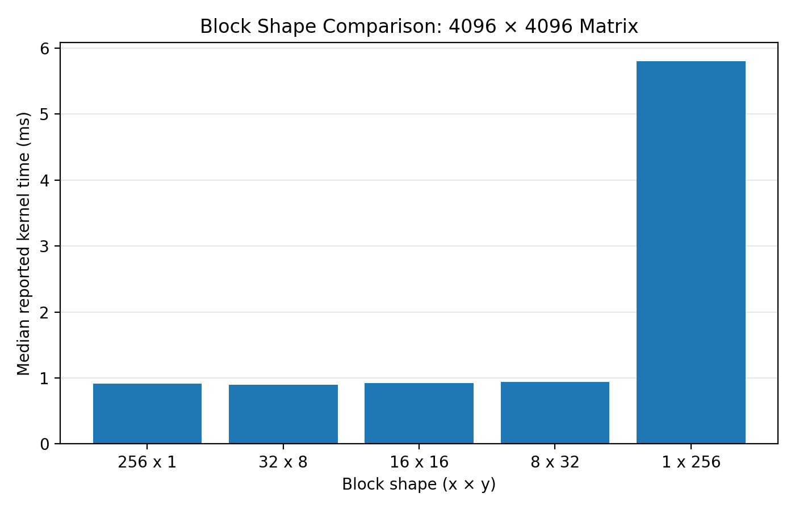

# Assignment 1: CUDA Matrix Addition

Implement element-wise matrix addition, **C = A + B**, using CUDA, then measure how matrix size, data transfers, and thread block configuration affect performance.

## Implementation

### Host-side code: `main.cu`

1. Allocate GPU memory for A, B, and C using `cudaMalloc`.
2. Copy A and B from CPU to GPU using `cudaMemcpy`.
3. Launch the matrix-addition kernel.
4. Copy C from GPU to CPU.
5. Verify the result against CPU calculations.
6. Release GPU memory using `cudaFree`.

CUDA API calls are wrapped in `CHECK(...)` for error handling.

### GPU-side code: `kernel.cu`

Each thread computes one matrix element:

```cpp
int col = blockIdx.x * blockDim.x + threadIdx.x;
int row = blockIdx.y * blockDim.y + threadIdx.y;

if (row < rows && col < cols) {
    size_t idx = (size_t)row * cols + col;
    C[idx] = A[idx] + B[idx];
}
```

Matrices use row-major storage. The grid rounds up to cover the entire matrix; the bounds check prevents extra threads from accessing invalid elements.

The default block configuration is **16 × 16 threads**.

## Build and Test

```bash
make
./mat-add
./mat-add 1024
./mat-add 4097 1023
compute-sanitizer ./mat-add 1023 517
```

All three correctness tests passed. The memory check reported **0 errors**.

## Experiment Results

The measurements below were collected in Google Colab on a Tesla T4 GPU. Each performance configuration was tested five times, with the median reported.

The starter program's kernel-stage timer includes launch and synchronization overhead; it is not a measurement of GPU execution alone. These Colab measurements do not replace any required Bender validation.

### Q1: Grid and Block Dimensions

For 4097 rows × 1023 columns with 16 × 16 blocks:

- Grid dimensions: **64 × 257 blocks**
- Total launched threads: **4,210,688**
- Valid matrix elements: **4,191,231**
- Threads doing no work: **19,457**

### Q2: Matrix Size

| Matrix size | Kernel data moved (MB) | Reported kernel time (ms) |
|---|---:|---:|
| 16 × 16 | 0.003072 | 0.118 |
| 64 × 64 | 0.049152 | 0.114 |
| 256 × 256 | 0.786432 | 0.124 |
| 1024 × 1024 | 12.582912 | 0.182 |
| 4096 × 4096 | 201.326592 | 1.001 |
| 8192 × 8192 | 805.306368 | 3.396 |
| 16384 × 16384 | 3221.225472 | 13.047 |

Each element requires two 4-byte reads and one 4-byte write, giving **12N² bytes** of logical kernel data movement. Here, 1 MB = 1,000,000 bytes.

Large-matrix time grows approximately with the number of elements. Small-matrix timings are strongly affected by fixed overhead.

The largest tested matrix was 16384 × 16384; the memory limit was not established.



### Q3: Transfers versus Computation

For the largest matrix, 16384 × 16384, the updated measurements were:

| Stage | Median time (ms) |
|---|---:|
| Host to device | 470.938 |
| Kernel | 13.176 |
| Device to host | 848.399 |
| Sum of stage medians | 1332.513 |

The kernel accounts for **0.99%** of these three stages combined.

The copies together move **12N² bytes**, matching the kernel's logical byte count, but cross the CPU–GPU connection rather than accessing only GPU memory.

Running the kernel 100 times with one initial input transfer and one final output transfer gives an estimated kernel share of **49.97%**, assuming unchanged per-launch time.

This illustrates the benefit of reusing data on the GPU. A CPU baseline is needed to establish actual speedup.

### Q4: Block Size

Matrix size: 4096 × 4096.

| Block size | Threads per block | Kernel time (ms) |
|---|---:|---:|
| 4 × 4 | 16 | 2.527 |
| 8 × 8 | 64 | 0.941 |
| 16 × 16 | 256 | 0.943 |
| 32 × 32 | 1024 | 0.930 |

The 4 × 4 block uses only half of a 32-thread warp and requires more blocks. The other configurations performed similarly.

A 64 × 64 block compiled but failed at launch: its 4096 threads exceed the 1024-thread-per-block limit.



### Q5: Block Shape

Matrix size: 4096 × 4096. Every block contains 256 threads.

| Block shape (x × y) | Kernel time (ms) | Correctness |
|---|---:|---|
| 256 × 1 | 0.911 | Passed |
| 32 × 8 | 0.896 | Passed |
| 16 × 16 | 0.924 | Passed |
| 8 × 32 | 0.937 | Passed |
| 1 × 256 | 5.796 | Passed |

The first four shapes performed similarly. The 1 × 256 shape was approximately **6.47× slower** than 32 × 8.

With row-major storage, adjacent columns are contiguous. The 1 × 256 shape makes neighboring warp threads access different rows, requiring many more memory transactions.

All shapes produced correct results. Default 16 × 16 blocks were restored afterward.



## Files

| Path | Purpose |
|---|---|
| `main.cu` | Memory allocation, transfers, verification, and cleanup |
| `kernel.cu` | GPU kernel and launch configuration |
| `support.cu`, `support.h`, `Makefile` | Provided support and build files |
| `report/A1Report.md` | Detailed report draft |
| `report/q*_timings.csv` | Recorded timing tables |
| `plots/` | Experiment plots |
| `REPORT.md` | Required final report location for submission |

## Submission Notes

- Transfer final answers into the root `REPORT.md`.
- Include the plots and verify that their relative links render on GitHub.
- Keep the source defaults at 16 × 16 blocks.
- Complete required Bender testing and check automated tests in the assignment repository.
