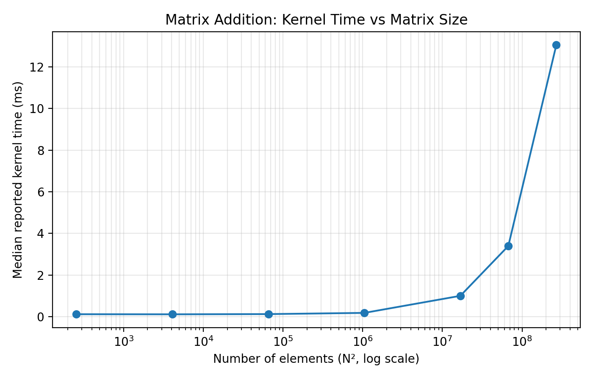
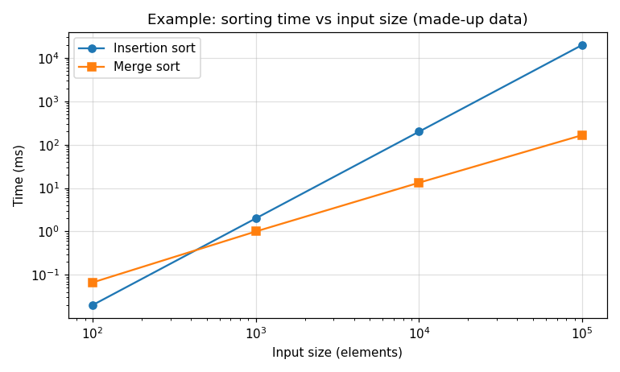

# Matrix Addition Report

**Name:** _your name_  
**SID:** _your student ID_  
**GitHub username:** _your username_

<details>
<summary><b>How to use this file</b> (click to expand)</summary>

Write each answer under its question, replacing the _italic placeholder_ text. Commit and push `REPORT.md` (and your `plots/` folder) together with your code, then open this file on GitHub to check that everything renders. That's the version your TA grades.

To preview locally, open this file in VS Code and press Ctrl+Shift+V (Cmd+Shift+V on a Mac).

**Plots.** Collect your own timings by running `./mat-add` with different sizes, then make the plot with any tool you like (Python/matplotlib, Excel, Google Sheets, gnuplot, ...). Label both axes with units. Export it as a PNG, save it in the `plots/` folder, and embed it like this:

```markdown

```

Use a relative path (`plots/...`), not a path on your computer, and match the file name's capitalization exactly: GitHub is case-sensitive.

Here is an example, embedded with ``. It has a title, labeled axes with units, a legend, and markers on the measured points. Log scales help when the values span several orders of magnitude.



**Tables.** Good for the raw numbers behind a plot:

```markdown
| Matrix size | Kernel (ms) | Host to device (ms) | Device to host (ms) |
|-------------|-------------|---------------------|---------------------|
| 1000 x 1000 | ...         | ...                 | ...                 |
| 4096 x 4096 | ...         | ...                 | ...                 |
```

**Math.** Use `$...$` inline and `$$...$$` on its own line:

```markdown
The speedup is $S = t_{\text{CPU}} / t_{\text{GPU}}$, and the total GPU time is

$$t_{\text{GPU}} = t_{\text{alloc}} + t_{\text{H2D}} + t_{\text{kernel}} + t_{\text{D2H}}$$
```

**Commands or code.** Put them in a fenced block:

````markdown
```bash
./mat-add 4096 4096
```
````

</details>

---

## Q1. Grid and block dimensions

How does your `basicMatAdd()` compute the grid and block dimensions for a `rows x cols` matrix? Why must the number of blocks be rounded up, and what does the kernel do so that the extra threads are harmless?

For `./mat-add 4097 1023` with 16 x 16 blocks: how many blocks does your launch use in each dimension, and how many threads do no work? Show how you computed it.

_Your answer here._

## Q2. Kernel time vs matrix size

Measure the kernel time for at least five square matrix sizes, from small (e.g. 16 x 16) to as large as your GPU's memory allows. Plot kernel time against the number of elements, and describe the trend.

How much data does the kernel move for an N x N matrix? Count the bytes it reads from and writes to GPU memory (each element is a 4-byte `float`), and add the data moved (in MB) for each of your sizes to your table or plot. As the amount of data grows, how does the kernel time grow? Why might small matrices not follow the same pattern?

_Your plot here, e.g. ``_

_Your answer here._

## Q3. Data transfer vs computation

For the sizes you used in Q2, record three times from the program's output: "Copying data from host to device", "Launching kernel", and "Copying data from device to host". Show them as a stacked bar chart (one bar per size) or a table.

1. For your largest size, what percentage of the total of these three times is the kernel?
2. How many bytes do the two copies move together, and how does that compare with the data the kernel moves (Q2)? Compare their times and explain the difference. Hint: where does the data travel in each case?
3. Suppose a program ran the kernel 100 times on the same A and B before copying C back. Estimate the kernel's percentage of the total time now. What does this suggest about when moving work to the GPU pays off?

_Your plot or table here_

_Your answer here._

## Q4. Block size

Pick one large matrix (e.g. 4096 x 4096) and measure the kernel time with 4 x 4, 8 x 8, 16 x 16 and 32 x 32 blocks. You can set the block size without editing code: `make TILE=8` builds with `TILE_SIZE` 8. Plot kernel time against threads per block, and explain the trend. Hint: how many threads are in a warp?

Then build with `make TILE=64` and run it. What happens, and why?

_Your plot here_

_Your answer here._

## Q5. Block shape and memory access

Keep 256 threads per block but change the block's shape (x by y): 256 x 1, 32 x 8, 16 x 16, 8 x 32 and 1 x 256. Build each shape with `make TILE_X=<x> TILE_Y=<y>`, e.g. `make TILE_X=32 TILE_Y=8`. Measure the kernel time for one large matrix and show the results in a plot or table.

Which shapes are fastest and slowest? Explain using how the 32 threads of a warp map onto the matrix, and where those elements sit in memory (the matrices are stored row-major). Is the result still correct for every shape?

_Your plot or table here_

_Your answer here._
