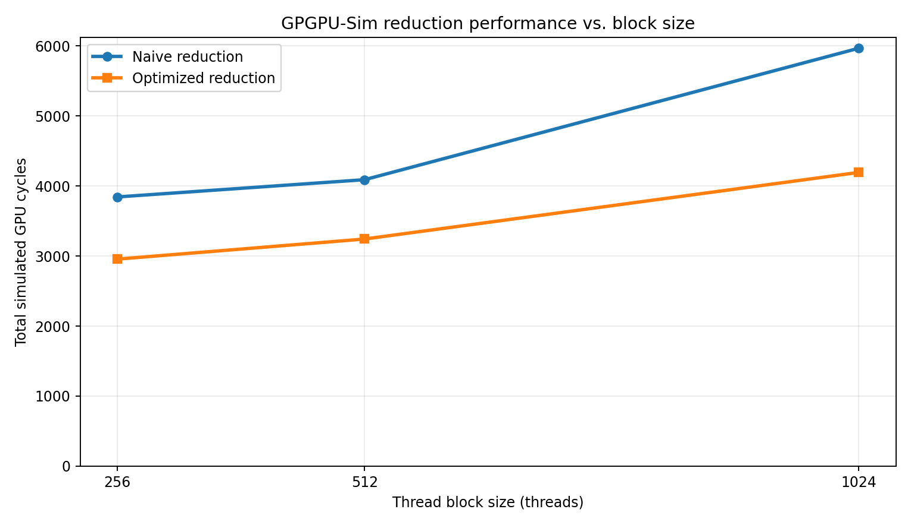
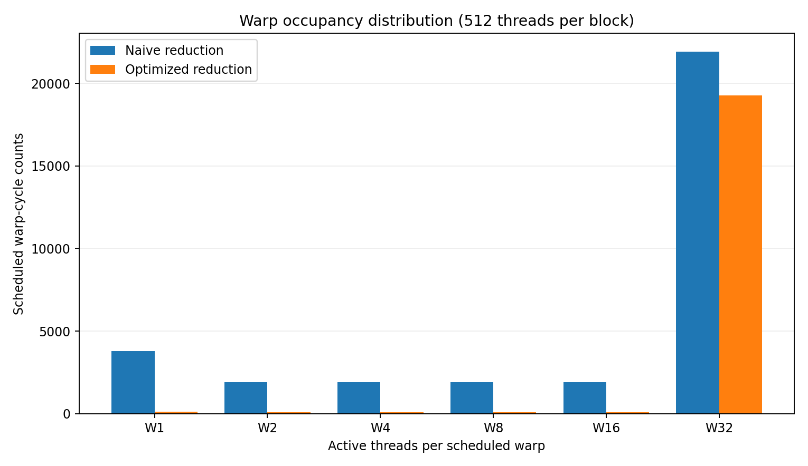

# CS/EE 217 — Assignment 2: Parallel Reduction

CUDA reduction kernels and a GPGPU-Sim study of thread indexing, warp divergence, and thread-block size.

## Overview

Parallel reduction combines an input array into partial sums using a tree of additions. In this assignment, each CUDA thread block processes up to `2 * BLOCK_SIZE` input elements using shared memory, then writes **one partial sum per block**. The host program verifies the partial sums against CPU results. The default `BLOCK_SIZE` is **512 threads**.

Two kernels are implemented in `kernel.cu`:

| Kernel | Thread participation | Expected divergence behavior |
|---|---|---|
| `naiveReduction` | `tid % stride == 0` with increasing stride | Active and inactive threads become interleaved within warps |
| `optimizedReduction` | `tid < stride` with decreasing stride | Active threads remain contiguous, reducing partially active warp execution |

Both kernels use shared memory, bounds-checked loads (including partially filled final blocks), and `__syncthreads()` between reduction stages.

## Correctness

Both kernels passed the tested input sizes **1,025**, **10,240**, and **1,000,000** on the Colab GPU. All six GPGPU-Sim runs for input size **10,240** also reported `TEST PASSED` (block sizes 256, 512, and 1024 for each kernel).

> Passing correctness tests verifies the resulting sums, but does not establish performance or divergence characteristics.

## Reduction stages and divergence

For the report's 1,024-thread-block example, each block reduces up to **2,048 elements**, requiring `log2(2048) = 11` reduction stages.

| Analytical result | Naive | Optimized |
|---|---:|---:|
| Stages without intra-warp divergence | 1 | 6 |
| Stages with intra-warp divergence | 10 | 5 |
| Total stages | 11 | 11 |

For the separate input-size example of **512,000** elements and **512 threads per block**, there are **500 blocks**, each executing **10 stages** to generate one partial sum. This counts stages per block, not 5,000 serial global steps.

## GPGPU-Sim performance results

**Configuration:** Course `socalucr/gpgpu-sim` image, GTX480 simulator configuration, **10,240 input elements**. The performance metric is `gpu_tot_sim_cycle` (total simulated GPU cycles; lower is better).



| Thread block size | Naive cycles | Optimized cycles | Optimized speedup (naive / optimized) |
|---:|---:|---:|---:|
| 256 | 3,844 | 2,956 | 1.30× |
| 512 | 4,090 | 3,243 | 1.26× |
| 1024 | 5,967 | 4,194 | 1.42× |

**Finding:** In this simulator configuration and workload, the optimized kernel used fewer simulated cycles at every tested block size, and **256 threads per block** had the lowest cycle count for both kernels. These observations do not imply that 256 is universally optimal on other GPUs or input sizes.

## Warp occupancy and divergence

The simulator's `W1`–`W32` counters report how many cycles a warp with the specified number of active threads was scheduled into the pipeline. `W32` means all 32 threads were active; `W1` means just one.



| Counter (512-thread blocks) | Naive | Optimized |
|---|---:|---:|
| W1 | 3,780 | 140 |
| W2 | 1,920 | 80 |
| W4 | 1,920 | 80 |
| W8 | 1,920 | 80 |
| W16 | 1,920 | 80 |
| W32 | 21,920 | 19,280 |

**Finding:** The optimized kernel has far fewer *partially active warp* counts. Raw `W32` totals should not be interpreted alone: the two implementations execute different total amounts of warp work.

## Implementation observation

An earlier, correct alternative reduction loop used `index = 2 * stride * tid` with a bounds condition, keeping the **participating thread IDs contiguous**. It produced correct sums but was not the assignment's intended interleaved naive participation pattern. The final active naive loop uses `tid % stride == 0`; the alternative remains commented out in `kernel.cu` for comparison. The alternative's GPGPU-Sim performance was **not measured**, so no speedup claim is made for it.

## Reproducing results

On a CUDA-enabled environment, from the assignment directory:

```bash
make clean && make
./reduction 10240
./reduction-optimized 10240
```

For the course GPGPU-Sim Docker environment, initialize the simulator with `source ~/gpgpu-sim_distribution/setup_environment`, build with `make clean && make`, and run from a directory containing the GTX480 `gpgpusim.config` and associated configuration files:

```bash
./reduction 10240 &> naive.out
./reduction-optimized 10240 &> optimized.out
grep gpu_tot_sim_cycle naive.out optimized.out
grep -A 2 'Warp Occupancy Distribution' naive.out optimized.out
```

For the block-size study, change `#define BLOCK_SIZE` in `kernel.cu` to 256, 512, or 1024, **rebuild between changes**, and restore **512** afterward. The course simulator is old (CUDA 4.0); a working directory with no spaces was used to avoid a PTX extraction failure observed with this setup.

## Files

- `kernel.cu` — naive and optimized CUDA kernels
- `A2Report.txt` — working answers to the professor's Q1–Q5 questions
- `REPORT.md` — instructor-provided graded report template (populate with final answers)
- `plots/` — figures used in this README and report
- `sim_results/` — raw GPGPU-Sim `.out` logs, if committed
- `main.cu`, `support.cu`, `support.h`, `Makefile` — instructor-provided code/build files

**Note:** This README is an assignment-level summary. The full question-by-question responses and source measurements belong in `REPORT.md`, `A2Report.txt`, and `sim_results/`.
