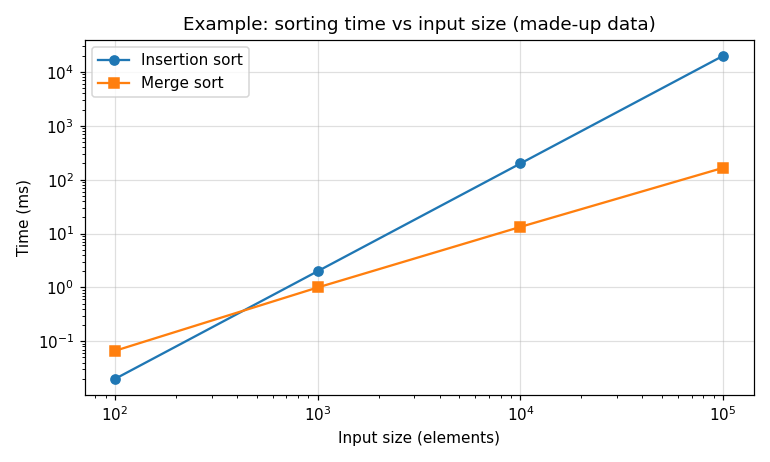

# Parallel Reduction Report

**Name:** _your name_  
**SID:** _your student ID_  
**GitHub username:** _your username_

<details>
<summary><b>How to use this file</b> (click to expand)</summary>

Write each answer under its question, replacing the _italic placeholder_ text. Commit and push `REPORT.md` (and your `plots/` folder) together with your code, then open this file on GitHub to check that everything renders. That's the version your TA grades.

To preview locally, open this file in VS Code and press Ctrl+Shift+V (Cmd+Shift+V on a Mac).

**Plots.** Collect your own measurements, then make the plot with any tool you like (Python/matplotlib, Excel, Google Sheets, gnuplot, ...). Label both axes with units. Export it as a PNG, save it in the `plots/` folder, and embed it like this:

```markdown

```

Use a relative path (`plots/...`), not a path on your computer, and match the file name's capitalization exactly: GitHub is case-sensitive.

Here is an example, embedded with ``. It has a title, labeled axes with units, a legend, and markers on the measured points. Log scales help when the values span several orders of magnitude.



**Tables.** Good for the raw numbers behind a plot:

```markdown
| Block size | Naive (cycles) | Optimized (cycles) |
|------------|----------------|--------------------|
| 256        | ...            | ...                |
| 512        | ...            | ...                |
| 1024       | ...            | ...                |
```

**Math.** Use `$...$` inline and `$$...$$` on its own line:

```markdown
The speedup is $S = t_{\text{naive}} / t_{\text{optimized}}$, and the mean of $n$ runs is

$$\bar{t} = \frac{1}{n} \sum_{i=1}^{n} t_i$$
```

**Commands, code or program output.** Put them in a fenced block, so the spacing is kept:

````markdown
```bash
./reduction-optimized 10240
```
````

</details>

---

## Q1. Naive reduction and divergence

Assume we run your naive reduction with an input size of 10,240 and a thread block size of 1024 threads.

### Q1.1

How many steps of your naive reduction kernel execute without divergence?

_Your answer here._

### Q1.2

How many steps of your naive reduction kernel execute with divergence?

_Your answer here._

## Q2. Optimized reduction and divergence

Assume we run your optimized reduction with an input size of 10,240 and a thread block size of 1024 threads.

### Q2.1

How many steps of your optimized reduction kernel execute without divergence?

_Your answer here._

### Q2.2

How many steps of your optimized reduction kernel execute with divergence?

_Your answer here._

## Q3. Number of steps

For a naive reduction with an input size of 512,000 and a thread block size of 512 threads, how many steps does the reduction algorithm perform? Assume an implementation similar to this assignment's, where each thread block only has to write its partial sum into an array.

_Your answer here._

## Q4. Warp occupancy distribution

How does the warp occupancy distribution compare between the two reduction implementations?

### Q4.1

Paste the warp occupancy distribution you observed for your naive reduction kernel.

_Your output here_

### Q4.2

Paste the warp occupancy distribution you observed for your optimized reduction kernel.

_Your output here_

### Q4.3

Which warp occupancy distribution is more desirable, and why?

_Your answer here._

## Q5. Block size

How does block size affect the amount of warp divergence in reduction? Run both kernels with thread block sizes of 256, 512 and 1024 threads, and look at the effect on performance and warp occupancy.

### Q5.1

Compared with 1024 threads, what trends do you notice in the warp occupancy distribution?

_Your plot or table here_

_Your answer here._

### Q5.2

Compared with 1024 threads, what performance trends do you notice? Say which metric you used to measure performance.

_Your plot or table here_

_Your answer here._
