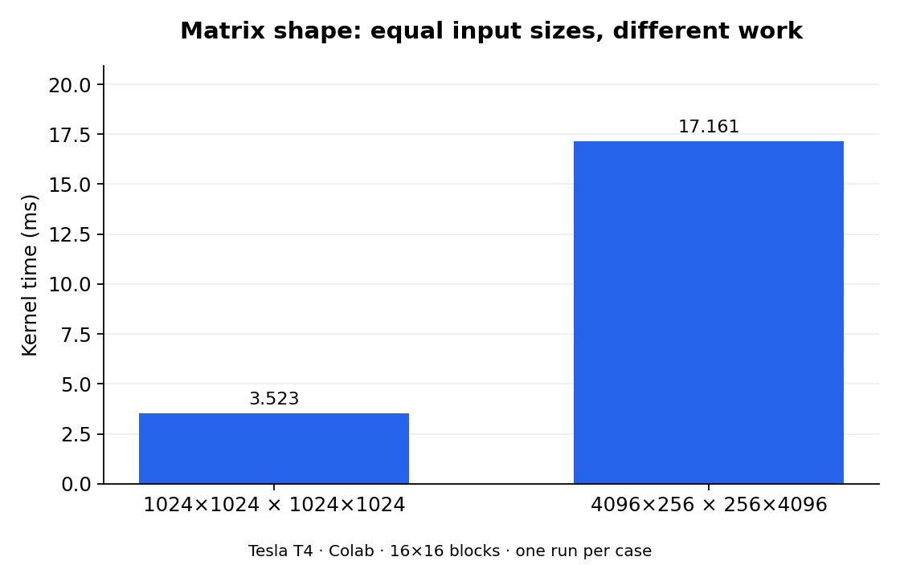
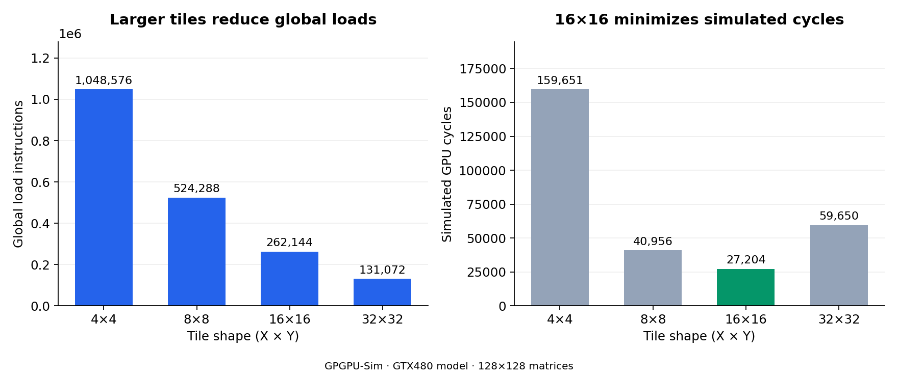
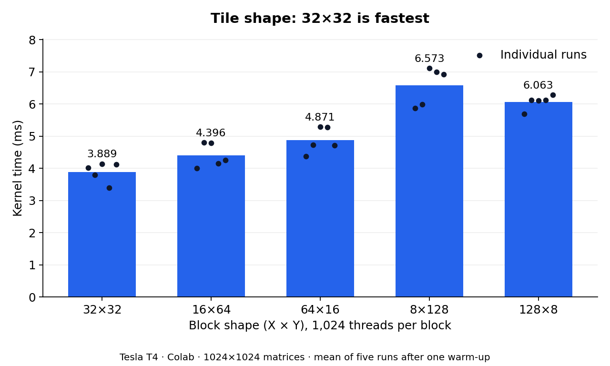

# A3 — Tiled Matrix Multiplication

CUDA matrix multiplication with shared-memory tiling, arbitrary matrix dimensions, and square or rectangular thread blocks.

**Main result:** larger tiles reduce repeated global loads, but the best performance depends on parallelism and access patterns. In the GTX480 simulation, **16×16** was fastest; among the five 1,024-thread shapes tested on a Tesla T4, **32×32** was fastest.

## Operation and implementation

For `A: m×k` and `B: k×n`, the output is `C: m×n`:

$$C_{r,c}=\sum_{p=0}^{k-1} A_{r,p}B_{p,c}.$$

| File | Role |
|---|---|
| `main.cu` | Allocate GPU memory, copy A and B to the GPU, invoke multiplication, retrieve C, verify against the CPU, and free memory |
| `kernel.cu` | Define the shared-memory kernel and launch dimensions |
| `support.cu`, `support.h`, `Makefile` | Provided support files; left unchanged |
| `REPORT.md` | Assignment answers and analysis |
| `plots/` | Figures embedded below |

Each thread computes one output element. A block computes `TILE_Y` rows by `TILE_X` columns of C. The implementation sets:

```cpp
const int TILE_K = (TILE_X < TILE_Y) ? TILE_X : TILE_Y;
__shared__ float tileA[TILE_Y][TILE_K];
__shared__ float tileB[TILE_K][TILE_X];
```

For each step along the inner dimension, threads load the input tiles, synchronize, accumulate partial dot products, and synchronize again before overwriting shared memory. Out-of-bounds input entries are zero-filled. Only in-bounds output threads write C. All threads reach both barriers, including those outside the output boundary.

Unlike A1 addition, which performs one addition per output, A3 performs a length-`k` dot product. Tiling lets neighboring output threads reuse input values through shared memory.

## Build and run

Run from the folder containing the Makefile. Use a CUDA GPU environment for hardware measurements, or the configured GPGPU-Sim container for simulation.

```bash
make                         # Default: 16×16 blocks
./sgemm-tiled                 # 1000×1000 matrices
./sgemm-tiled 128             # Square matrices
./sgemm-tiled 33 17 65        # A: 33×17; B: 17×65; C: 33×65

make TILE=8                  # 8×8 blocks
make TILE_X=32 TILE_Y=8       # Rectangular blocks
make                         # Restore 16×16 defaults
```

The command-line order is **m, k, n**. The kernel interface takes **m, n, k**; the starter host code already performs that mapping.

When switching between the real GPU and simulator, use `make clean` before rebuilding. Do not reuse a binary from the other environment.

## Correctness checks observed

| Matrix dimensions (m, k, n) | Block shape | Verified output elements |
|---|---|---:|
| 4, 4, 4 | 16×16 | 16 |
| 33, 17, 65 | 16×16, 32×8, 8×32 | 2,145 per run |
| 128, 128, 128 | 16×16 | 16,384 |
| 1024, 1024, 1024 | 16×16 and all five Q5 shapes | 1,048,576 per run |
| 4096, 256, 4096 | 16×16 | 16,777,216 |
| 128, 128, 128 (simulation) | 4×4, 8×8, 16×16, 32×32 | 16,384 per run |

These runs printed `TEST PASSED`. Sanitizer checks and the complete automated grading suite are not documented as completed here.

## Q1–Q2: why tiling reduces loads

| Case | Loads per A element | Loads per B element |
|---|---:|---:|
| 128×128, tiled with 16×16 blocks (Q1) | 8 | 8 |
| 256×256, non-tiled (Q2) | 256 | 256 |
| 256×256, tiled with 16×16 blocks (equal-size comparison) | 16 | 16 |

An A element is loaded once per output block column; a B element once per output block row. Within a 16×16 block, each loaded input value is reused for 16 output elements.

Q2 has **32×** as many loads per input element as Q1, combining a doubled matrix dimension with the benefit of tiling. At the same matrix size, 16×16 tiling reduces these loads by **16×**. Counts describe algorithmic loads; caches can reduce traffic reaching physical GPU memory.

## Q3: equal input sizes do not mean equal work

Measured on **Google Colab, Tesla T4**, using **16×16 blocks**. These are single-run kernel-section timings from the starter program, including launch and synchronization overhead.

| Measurement | Square | Rectangular |
|---|---:|---:|
| A | 1024×1024 | 4096×256 |
| B | 1024×1024 | 256×4096 |
| Elements in each input | 1,048,576 | 1,048,576 |
| C elements / launched threads | 1,048,576 | 16,777,216 |
| Launched blocks | 4,096 | 65,536 |
| Multiply-adds per thread | 1,024 | 256 |
| Total multiply-adds | 1,073,741,824 | 4,294,967,296 |
| Kernel time | **3.523 ms** | **17.161 ms** |



The rectangular case took **4.87×** as long. It generates **16×** more output elements, with one-quarter the work per output, for **4×** the total arithmetic. It also writes 16× more output data. Launched threads execute in scheduled blocks over time, rather than all simultaneously.

## Q4: tile size in GPGPU-Sim

**Platform:** GPGPU-Sim, configured to model an NVIDIA GTX480. **Matrices:** 128×128. Simulator cycles are separate from the T4 wall-clock measurements.

| Tile | Global load instructions | Global store instructions | Shared-memory instructions | Simulated cycles |
|---|---:|---:|---:|---:|
| 4×4 | 1,048,576 | 16,384 | 5,242,880 | 159,651 |
| 8×8 | 524,288 | 16,384 | 4,718,592 | 40,956 |
| 16×16 | 262,144 | 16,384 | 4,456,448 | **27,204** |
| 32×32 | **131,072** | 16,384 | 4,325,376 | 59,650 |



For square matrices where `N` is divisible by the square tile width `T`:

$$L_{\mathrm{global}}=2N^2\frac{N}{T}.$$

Doubling tile width halves input loads. Stores remain `128×128 = 16,384`, because every output is written once. Thus **32×32 minimizes global accesses**, while **4×4 maximizes them**.

However, **16×16 is fastest**. The 4×4 blocks have only 16 threads, leaving half a warp inactive, and require more tile steps and barriers. The 32×32 blocks contain 1,024 threads. Given the simulated SM's 1,536-thread limit, only one such block fits per SM; the remaining 512-thread capacity cannot fit another block. A 16×16 block has 256 threads, permitting up to six blocks based on the thread limit alone, subject to registers, shared memory, and block limits.

The small problem also has only 16 blocks with 32×32 tiles versus 64 with 16×16 tiles. These parallelism constraints help explain why fewer loads do not yield fewer cycles: 32×32 takes **2.19×** the cycles of 16×16. This is an interpretation of the measured trend, rather than a direct measurement of its individual causes.

### Reproduce simulator measurements

Inside the existing configured container:

```bash
source /root/gpgpu-sim_distribution/setup_environment
# Change to the directory containing the A3 source files.
cp -a /root/gpgpu-sim_distribution/configs/GTX480/* .
make clean
for tile in 4 8 16 32; do
    make TILE="$tile" && ./sgemm-tiled 128 > "/tmp/a3_tile${tile}.log" 2>&1
done
grep -E 'TEST PASSED|gpgpu_n_load_insn|gpgpu_n_store_insn|gpgpu_n_shmem_insn|gpu_tot_sim_cycle' /tmp/a3_tile*.log
make
```

Keep simulator logs outside the repository; they are not included in this package.

## Q5: tile shape with 1,024 threads per block

For `A: m×k`, `B: k×n`, and block shape `X×Y`:

$$L_A=\left\lceil\frac{n}{X}\right\rceil,\qquad L_B=\left\lceil\frac{m}{Y}\right\rceil.$$

These are loads **per input element**. Total input-element loads are:

$$L_{\mathrm{total}}=mk\left\lceil\frac{n}{X}\right\rceil+kn\left\lceil\frac{m}{Y}\right\rceil.$$

**Platform:** Colab Tesla T4. **Matrices:** 1024×1024. Each shape was run once as a warm-up, followed by five measured runs of the starter executable. Each run used a separate process; the warm-up does not eliminate per-process CUDA startup or first-launch overhead.

| Shape (X×Y) | Loads/A element | Loads/B element | Total input loads | TILE_K | Inner tile steps | Mean time |
|---|---:|---:|---:|---:|---:|---:|
| 32×32 | 32 | 32 | **67,108,864** | 32 | 32 | **3.889 ms** |
| 16×64 | 64 | 16 | 83,886,080 | 16 | 64 | 4.396 ms |
| 64×16 | 16 | 64 | 83,886,080 | 16 | 64 | 4.871 ms |
| 8×128 | 128 | 8 | **142,606,336** | 8 | 128 | **6.573 ms** |
| 128×8 | 8 | 128 | **142,606,336** | 8 | 128 | 6.063 ms |



The overall ranking agrees with the load-count prediction: **32×32 is fastest**, and the extreme aspect ratios are slowest. The slowest mean, 8×128, is **1.69×** the fastest.

Warp mapping and this implementation's loading scheme also matter:

| TILE_X | Output positions covered by one warp |
|---|---|
| 8 | Four rows, eight consecutive columns per row |
| 16 | Two rows, sixteen consecutive columns per row |
| 32, 64, 128 | Thirty-two consecutive columns in one row |

Threads are ordered with `threadIdx.x` varying fastest, and row-major storage puts adjacent columns at adjacent addresses. With wide blocks, only threads satisfying `threadIdx.x < TILE_K` load A, so some warps have few or no active A-loading lanes. For B, only rows satisfying `threadIdx.y < TILE_K` load values. Actual loading efficiency therefore depends on the active lanes as well as the output layout.

Extreme shapes use `TILE_K=8`, requiring four times as many tile steps and barrier encounters as 32×32. Shapes with equal load counts can still differ due to access patterns, shared-memory behavior, and timing variability. The samples overlap; additional profiling would be needed to establish the causes of the smaller differences.

<details>
<summary>Five measured kernel-section times per shape (ms)</summary>

| Shape | Run 1 | Run 2 | Run 3 | Run 4 | Run 5 |
|---|---:|---:|---:|---:|---:|
| 32×32 | 4.009 | 3.787 | 4.139 | 3.392 | 4.120 |
| 16×64 | 3.994 | 4.796 | 4.784 | 4.149 | 4.256 |
| 64×16 | 4.374 | 4.722 | 5.286 | 5.269 | 4.705 |
| 8×128 | 5.865 | 5.980 | 7.110 | 6.989 | 6.920 |
| 128×8 | 5.691 | 6.119 | 6.111 | 6.115 | 6.278 |

</details>

## Scope and submission notes

- Hardware timings were collected on **Colab Tesla T4**, not the assignment's requested Bender platform. Repeat Q3/Q5 on Bender if required for grading.
- Simulator results model a **GTX480**; do not compare its cycle counts directly with T4 timings.
- This README summarizes the work; complete the provided `REPORT.md` with the required identifying information and final answers.
- Restore the default 16×16 configuration before final submission, and check the automated tests on the final commit.
- The companion `measurements.csv` records the numeric values used in the figures. This package contains documentation and plots, not modified CUDA source files.
