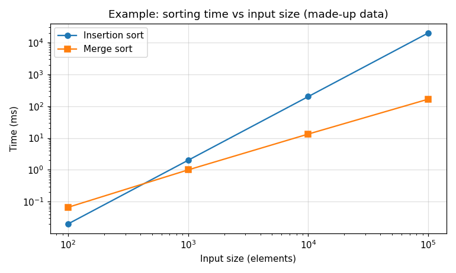

# Tiled Matrix Multiplication Report

**Name:** _your name_  
**SID:** _your student ID_  
**GitHub username:** _your username_

<details>
<summary><b>How to use this file</b> (click to expand)</summary>

Write each answer under its question, replacing the _italic placeholder_ text. Commit and push `REPORT.md` (and your `plots/` folder) together with your code, then open this file on GitHub to check that everything renders. That's the version your TA grades.

To preview locally, open this file in VS Code and press Ctrl+Shift+V (Cmd+Shift+V on a Mac).

**Plots.** Collect your own timings by running `./sgemm-tiled` with different sizes, then make the plot with any tool you like (Python/matplotlib, Excel, Google Sheets, gnuplot, ...). Label both axes with units. Export it as a PNG, save it in the `plots/` folder, and embed it like this:

```markdown

```

Use a relative path (`plots/...`), not a path on your computer, and match the file name's capitalization exactly: GitHub is case-sensitive.

Here is an example, embedded with ``. It has a title, labeled axes with units, a legend, and markers on the measured points. Log scales help when the values span several orders of magnitude.



**Tables.** Good for the raw numbers behind a plot:

```markdown
| Tile size | Global loads | Global stores | Shared memory instructions |
|-----------|--------------|---------------|----------------------------|
| 8 x 8     | ...          | ...           | ...                        |
| 16 x 16   | ...          | ...           | ...                        |
```

**Math.** Use `$...$` inline and `$$...$$` on its own line:

```markdown
The reduction in global loads is $R = L_{\text{non-tiled}} / L_{\text{tiled}}$, and the mean of $n$ runs is

$$\bar{t} = \frac{1}{n} \sum_{i=1}^{n} t_i$$
```

**Commands, code or program output.** Put them in a fenced block, so the spacing is kept:

````markdown
```bash
./sgemm-tiled 128
```
````

</details>

---

## Q1. Loads per element

_Conceptual question: no program needed._

For a 128 x 128 square *tiled* matrix multiplication with 16 x 16 tiles, how many times is each element of the input matrices loaded from global memory? Show how you computed it.

_Your answer here._

## Q2. Tiled vs non-tiled

_Conceptual question: no program needed._

For a 256 x 256 square *non-tiled* matrix multiplication, how many times is each element of the input matrices loaded from global memory? How does this compare with the tiled kernel from Q1, and why?

_Your answer here._

## Q3. Square vs rectangular matrices

On Bender, compare the execution time of a 1024 x 1024 square matrix multiplication with a 4096 x 256 by 256 x 4096 rectangular one (`./sgemm-tiled 4096 256 4096`). All input matrices have about 1M entries. Which is faster? Compare the size of the output matrix and the number of threads in each case, and explain what you observe.

_Your table or answer here._

## Q4. GPGPU-Sim memory statistics

Run your tiled kernel under GPGPU-Sim (see the setup guide) on a 128 x 128 matrix multiplication (`./sgemm-tiled 128`) with tile sizes of 4, 8, 16 and 32. Set the tile size without editing code: `make TILE=8` builds with 8 x 8 tiles. Record `gpgpu_n_load_insn`, `gpgpu_n_store_insn`, `gpgpu_n_shmem_insn` and `gpu_tot_sim_cycle` (the total number of simulated GPU cycles, which measures the kernel's run time) for each, and show them in a plot or table. Do not commit the simulator's output files.

_Your plot or table here_

Q4.1 and Q4.2 use your results from this simulation.

### Q4.1

Which tile size resulted in the fewest accesses to global memory, and which resulted in the most? Explain.

_Your answer here._

### Q4.2

Which tile size performed the fastest, and which the slowest? Use `gpu_tot_sim_cycle` from the table above as the measure of performance (fewer cycles is faster), and explain why you think that is. Hint: how many threads can one SM of the simulated GPU hold?

_Your answer here._

## Q5. Tile shape

Keep 1024 threads per block but change the tile's shape (x by y): 32 x 32, 16 x 64, 64 x 16, 8 x 128 and 128 x 8. Build each shape with `make TILE_X=<x> TILE_Y=<y>`, e.g. `make TILE_X=16 TILE_Y=64`. Your kernel must still give the correct answer for every shape. Measure the kernel time for each shape on Bender with one large matrix (e.g. 1024 x 1024) and show the results in a plot or table. Bender's GPUs are shared, so run each shape several times and report the average.

### Q5.1

For an `m x k` by `k x n` multiplication with a tile of `TILE_X x TILE_Y`, how many times is each element of A loaded from global memory, and how many times is each element of B? Write your answer in terms of `m`, `n`, `TILE_X` and `TILE_Y`, and use it to say which shapes should load the least and the most data.

_Your answer here._

### Q5.2

Which shapes were fastest and slowest on Bender? Does this agree with your answer to Q5.1? Explain any difference using how the 32 threads of a warp map onto the matrix, and where those elements sit in memory (the matrices are stored row-major). To justify the trends you observe, you may also use GPGPU-Sim statistics such as `gpgpu_n_load_insn` and `gpgpu_n_shmem_insn` (use a small matrix, e.g. 128 x 128, in the simulator).

_Your plot or table here_

_Your answer here._
