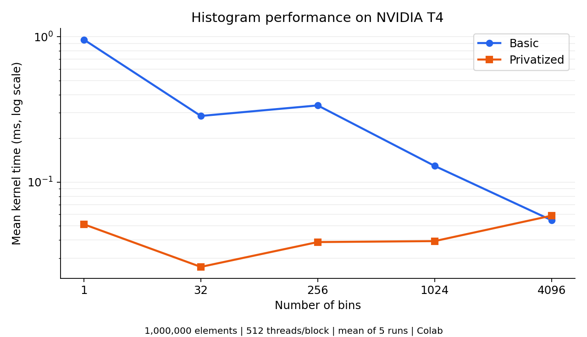
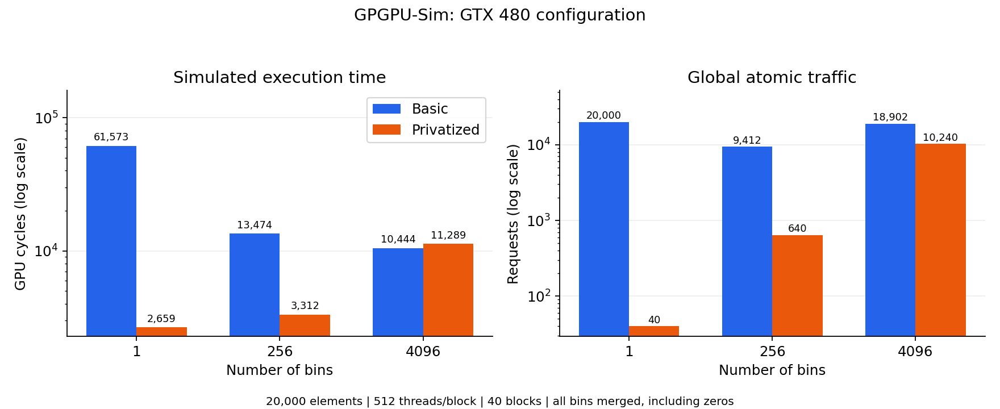

# Assignment 4: CUDA Histogram

Implement and compare a basic histogram with a privatized histogram using CUDA atomic operations and shared memory.

**Main result:** privatization is 18.60× faster with one bin on the Colab T4, but the basic kernel is about 1.07× faster with 4096 bins. Counting locally reduces contention, while initializing and merging large private histograms adds work.

## Implementation

A histogram counts how many input elements fall into each bin. For example, input `[0, 2, 1, 2, 0, 2]` produces bins `[2, 1, 3]`.

| Detail | Basic | Privatized |
|---|---|---|
| Local counting | Global-memory `atomicAdd` | Shared-memory `atomicAdd` |
| Private histogram | None | One per block, allocated dynamically |
| Global updates | One per input element | One per bin per block |
| Synchronization | No block barrier needed | Barriers after initialization and counting |
| Block size | 512 threads | 512 threads |

Each thread processes one input element when its global index is valid. The grid contains `ceil(N / 512)` blocks. The privatized kernel proceeds in three phases:

1. Initialize the block's shared histogram to zero.
2. Count valid input elements into shared bins using `atomicAdd`.
3. Merge every private bin into the global histogram using `atomicAdd`, including zero-count bins.

Both barriers are outside the input bounds check so every thread participates. Initialization and merge loops use a stride of `blockDim.x`, covering bin counts above 512. With 4096 bins, each thread handles eight bins in each loop. Dynamic shared memory requires `num_bins * sizeof(unsigned int)` bytes per block (16 KiB at 4096 bins).

## Operation counts

These are logical operations in the source algorithm, not simulator memory requests. Let **N** be the input size, **G** the number of blocks, and **H** the number of bins. Each input is counted once, and all private bins are merged.

| Quantity | Basic | Privatized |
|---|---:|---:|
| Input reads from global memory | N | N |
| Shared-memory atomic operations | 0 | N |
| Global-memory atomic operations | N | G × H |
| Total global reads, counting each atomic as one read | 2N | N + G × H |
| Total global writes, counting each atomic as one write | N | G × H |

For the report's conceptual case, **G = 8** and **H = 2048**: the privatized kernel performs **N + 16,384 global reads**, **16,384 global writes**, **N shared atomics**, and **16,384 global atomics**. Ordinary shared-memory initialization stores are not atomic operations.

## Correctness and sanitizer checks

The supplied CPU reference compares every histogram bin and the total count.

| Check | Input elements | Bins | Result |
|---|---:|---:|---|
| Basic and privatized correctness | 1,000,000 | 4096 | Both passed |
| Basic and privatized partial-block/bin-loop case | 1025 | 513 | Both passed |
| Privatized small-bin case | 10,000 | 33 | Passed |
| Basic memory check | 1025 | 513 | 0 errors |
| Privatized memory check | 1025 | 513 | 0 errors |
| Privatized racecheck | 10,000 | 4096 | 0 errors, 0 warnings |
| Privatized synccheck | 10,000 | 33 | 0 errors |

All 50 real-GPU timing runs and all six simulator runs also passed correctness checks. Sanitizer execution times are excluded from performance results.

## Real GPU results: Colab NVIDIA T4

**Configuration:** 1,000,000 input elements, 512 threads per block, 1954 blocks, five runs per case. Values are arithmetic means of the CUDA-event **Kernel time** measurements. These measurements were collected on **Colab T4, rather than Bender**.



| Bins | Basic mean (ms) | Privatized mean (ms) | Speedup: basic / privatized | Faster |
|---:|---:|---:|---:|---|
| 1 | 0.954387 | 0.051309 | 18.60× | Privatized |
| 32 | 0.285146 | 0.026150 | 10.90× | Privatized |
| 256 | 0.336922 | 0.038739 | 8.70× | Privatized |
| 1024 | 0.129325 | 0.039334 | 3.29× | Privatized |
| 4096 | 0.054765 | 0.058822 | 0.93× | Basic |

The basic kernel generally improves as bins increase because updates are distributed across more global counters. The increase from 32 to 256 bins shows that contention alone does not explain every measurement. Atomic-update combining and memory behavior are possible contributors, but these runs do not isolate their effects. No instruction-level confirmation of combining was collected. The one-bin basic runs also varied from 0.836192 to 1.202432 ms; the table retains all five runs in the average.

The privatized kernel is fastest at 32 bins. One bin still causes contention inside each block's shared histogram. As bins grow, initialization and merging cost more. At 4096 bins, its merge issues **1954 × 4096 = 8,003,584 logical global atomic operations**, compared with **1,000,000** in the basic kernel. The added work helps explain the crossover at 4096 bins.

## GPGPU-Sim results: GTX 480

**Configuration:** 20,000 input elements, 512 threads per block, 40 blocks. The privatized implementation merges all bins, including zeros. Timing uses **gpu_sim_cycle**, not CUDA-event milliseconds.



| Bins | Basic cycles | Privatized cycles | Basic global atomic requests | Privatized global atomic requests | Speedup: basic cycles / privatized cycles |
|---:|---:|---:|---:|---:|---:|
| 1 | 61,573 | 2,659 | 20,000 | 40 | 23.16× |
| 256 | 13,474 | 3,312 | 9,412 | 640 | 4.07× |
| 4096 | 10,444 | 11,289 | 18,902 | 10,240 | 0.93× |

### Atomic operations and requests

One **operation** is one thread's global `atomicAdd`. One **request** is a memory packet that can carry multiple operations. Sum the counts in braces in `traffic_breakdown_coretomem[GLOBAL_ATOMIC]`; the leading total is bytes. For example, `{40:4145,72:1217,136:4050,}` contains **9412 requests**.

| Bins | Basic logical global atomics | Basic requests | Privatized logical global atomics | Privatized requests |
|---:|---:|---:|---:|---:|
| 1 | 20,000 | 20,000 | 40 | 40 |
| 256 | 20,000 | 9,412 | 10,240 | 640 |
| 4096 | 20,000 | 18,902 | 163,840 | 10,240 |

With one bin, request counts equal operation counts in these runs. Basic updates to the same address are sent separately; privatization needs only one global update per block.

For 256 and 4096 bins, the simulator can group operations within a half-warp. Basic random updates coalesce less often as the address range grows. The privatized merge uses consecutive threads for consecutive bins, allowing **16 operations per request**: 10,240 / 16 = 640 requests, and 163,840 / 16 = 10,240 requests. Shared-memory atomics remain on the SM and do not appear in the global atomic request count.

### Simulated performance trend

Privatization reduces cycles most strongly at one bin (23.16×), where the basic kernel has severe contention for a single global counter. At 256 bins the advantage drops to 4.07×. At 4096 bins the basic kernel is about 1.08× faster: contention is lower, while privatization must initialize and merge many more bins. Even though privatization sends fewer global atomic requests at 4096 bins, its shared-memory phases, barriers, and merge work still contribute to execution time. Request count alone does not determine performance.

The T4 and simulated GTX 480 use different hardware and input sizes; their speedups describe their respective experiments and should not be treated as directly interchangeable.

## Build and run

On the real GPU environment:

```bash
make clean
make
./histogram-basic 1000000 4096
./histogram-privatized 1000000 4096
```

For a Colab cell, prefix individual shell commands with `!`, or use `%%bash` for a multiline shell cell.

Sanitizer commands:

```bash
compute-sanitizer ./histogram-basic 1025 513
compute-sanitizer ./histogram-privatized 1025 513
compute-sanitizer --tool racecheck ./histogram-privatized 10000 4096
compute-sanitizer --tool synccheck ./histogram-privatized 10000 33
```

Inside the configured GPGPU-Sim container:

```bash
cp -a ~/gpgpu-sim_distribution/configs/GTX480/* .
make clean
make
./histogram-basic 20000 256 > /tmp/a4-basic-256.out 2>&1
./histogram-privatized 20000 256 > /tmp/a4-privatized-256.out 2>&1
grep -E 'gpu_sim_cycle|traffic_breakdown_coretomem\[GLOBAL_ATOMIC\]|TEST' /tmp/a4-*-256.out
```

Rebuild when switching between simulator and real GPU environments. The supplied Makefile selects `sm_20` under the simulator's CUDA 4.0 compiler.

## Files and submission

| File | Purpose |
|---|---|
| `kernel.cu` | Both kernels and host launch functions |
| `main.cu`, `support.cu`, `support.h`, `Makefile` | Supplied driver, validation, and build files |
| `REPORT.md` | Required assignment answers |
| `README.md` | Project summary and experiment results |
| `plots/` | Figures embedded in Markdown |

Keep the required answers in `REPORT.md`; this README is a companion summary. Do not commit GPGPU-Sim output files. All figures here use relative paths so they render on GitHub.
