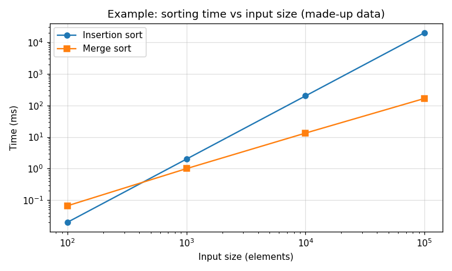

# Histogram Report

**Name:** _your name_  
**SID:** _your student ID_  
**GitHub username:** _your username_

<details>
<summary><b>How to use this file</b> (click to expand)</summary>

Write each answer under its question, replacing the _italic placeholder_ text. Commit and push `REPORT.md` (and your `plots/` folder) together with your code, then open this file on GitHub to check that everything renders. That's the version your TA grades.

To preview locally, open this file in VS Code and press Ctrl+Shift+V (Cmd+Shift+V on a Mac).

**Plots.** Collect your own measurements, then make the plot with any tool you like (Python/matplotlib, Excel, Google Sheets, gnuplot, ...). Label both axes with units. Export it as a PNG, save it in the `plots/` folder, and embed it like this:

```markdown

```

Use a relative path (`plots/...`), not a path on your computer, and match the file name's capitalization exactly: GitHub is case-sensitive.

Here is an example, embedded with ``. It has a title, labeled axes with units, a legend, and markers on the measured points. Log scales help when the values span several orders of magnitude.



**Tables.** Good for the raw numbers behind a plot:

```markdown
| Bins | Basic (ms) | Privatized (ms) |
|------|------------|-----------------|
| 1    | ...        | ...             |
| 32   | ...        | ...             |
| 4096 | ...        | ...             |
```

**Math.** Use `$...$` inline and `$$...$$` on its own line:

```markdown
Each block performs $2048$ atomic operations, so the grid performs $8 \times 2048$ in total, and the mean of $n$ runs is

$$\bar{t} = \frac{1}{n} \sum_{i=1}^{n} t_i$$
```

**Commands, code or program output.** Put them in a fenced block, so the spacing is kept:

````markdown
```bash
./histogram-privatized 1000000 1024
```
````

</details>

---

## Q1. Privatized histogram

_Conceptual question: no program needed._

Assume you perform a histogram operation on an array of size N, using 8 blocks with a block size of B and 2048 bins. Assume a privatized histogram implementation, where each block counts into its own histogram in shared memory and then adds it to the histogram in global memory. Assume every block adds all 2048 bins of its private histogram to the global histogram, without skipping bins that are zero. Count each `atomicAdd` to global memory as one global memory read and one global memory write. Show how you computed each answer.

### Q1.1

How many global memory reads are performed during the histogram kernel?

_Your answer here._

### Q1.2

How many global memory writes are performed during the histogram kernel?

_Your answer here._

### Q1.3

How many atomic operations to shared memory are performed?

_Your answer here._

### Q1.4

How many atomic operations to global memory are performed?

_Your answer here._

## Q2. Basic histogram

_Conceptual question: no program needed._

Assume the same histogram operation as in Q1 (an array of size N, 8 blocks, a block size of B and 2048 bins), but with a non-privatized (basic) histogram implementation, where every thread updates the histogram in global memory directly.

### Q2.1

How many atomic operations to shared memory are performed?

_Your answer here._

### Q2.2

How many atomic operations to global memory are performed?

_Your answer here._

## Q3. Basic vs privatized

On Bender, run both of your kernels with an input of 1,000,000 elements and 1, 32, 256, 1024 and 4096 bins (e.g. `./histogram-basic 1000000 32` and `./histogram-privatized 1000000 32`). Record the `Kernel time` line for each, and show both kernels in one plot or table. It is measured on the GPU with CUDA events. Don't use the `Launching kernel...` line, which is mostly kernel launch overhead. Bender's GPUs are shared, so run each case several times and report the average.

### Q3.1

How does the kernel time of each implementation change with the number of bins, and why? Explain the trends you measured, whichever way they go. Consider how many threads update the same counter at the same time, how much work each block of the privatized kernel does to zero its private histogram and add it to the global one, and that recent GPUs can combine atomic updates from the threads of a warp to the same address into one operation. You can see which atomic instructions each kernel uses with `cuobjdump -sass histogram-privatized | grep -E "ATOM|RED"`.

_Your plot or table here_

_Your answer here._

### Q3.2

Which implementation is faster, by how much, and for which numbers of bins does privatization help the most and the least? Explain.

_Your answer here._

## Q4. GPGPU-Sim atomic statistics

Run both kernels under GPGPU-Sim (see the setup guide) with an input of 20,000 elements and 1, 256 and 4096 bins (e.g. `./histogram-basic 20000 1`). Each run takes under a minute. For each run, record:

- `gpu_sim_cycle`, the number of simulated GPU cycles the kernel took (`Kernel time` is not measured in the simulator);
- the number of global atomic requests: the sum of the counts in the braces of `traffic_breakdown_coretomem[GLOBAL_ATOMIC]`. The braces list `packet size:count` pairs, so `= 45608 {40:8,72:629,}` means 8 + 629 = 637 requests.

Show the results in a table, and say how many blocks your privatized kernel launches for 20,000 elements, and whether it skips adding bins that are zero.

_Your table here_

### Q4.1

With 1 bin, compare the number of global atomic requests of each kernel with your answers to Q1.4 and Q2.2, using N = 20,000 and your number of blocks. Do they match?

_Your answer here._

### Q4.2

With 256 and 4096 bins, the number of global atomic requests is not the number of global atomic operations your Q1.4 and Q2.2 formulas predict. Why? Consider how the threads of a warp, and their atomic operations, can share one memory request.

_Your answer here._

### Q4.3

Compare `gpu_sim_cycle` of the two kernels for each number of bins. Explain the differences, including how the gap between the kernels changes as the number of bins grows.

_Your answer here._
