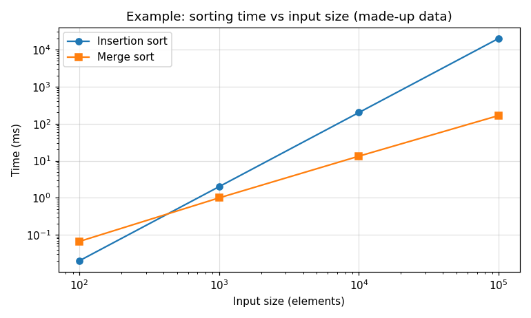

# Tile-Based Matrix Multiplication (cuTile) Report

**Name:** _your name_  
**SID:** _your student ID_  
**GitHub username:** _your username_

<details>
<summary><b>How to use this file</b> (click to expand)</summary>

Write each answer under its question, replacing the _italic placeholder_ text. Commit and push `REPORT.md` (and your `plots/` folder) together with your code, then open this file on GitHub to check that everything renders. That's the version your TA grades.

To preview locally, open this file in VS Code and press Ctrl+Shift+V (Cmd+Shift+V on a Mac).

**Plots.** Collect your own timings by running `python main.py` (cuTile) and your CUDA kernel from the Matrix Multiply assignment with different sizes, then make the plot with any tool you like (Python/matplotlib, Excel, Google Sheets, gnuplot, ...). Label both axes with units. Export it as a PNG, save it in the `plots/` folder, and embed it like this:

```markdown

```

Use a relative path (`plots/...`), not a path on your computer, and match the file name's capitalization exactly: GitHub is case-sensitive.

Here is an example, embedded with ``. It has a title, labeled axes with units, a legend, and markers on the measured points. Log scales help when the values span several orders of magnitude.



**Tables.** Good for the raw numbers behind a plot:

```markdown
| Size | CUDA tiled (ms) | cuTile (ms) |
|------|-----------------|-------------|
| 512  | ...             | ...         |
| 1024 | ...             | ...         |
```

**Math.** Use `$...$` inline and `$$...$$` on its own line:

```markdown
The speedup is $\frac{t_{CUDA}}{t_{cuTile}}$, and the mean of $n$ runs is

$$\bar{t} = \frac{1}{n} \sum_{i=1}^{n} t_i$$
```

**Commands, code or program output.** Put them in a fenced block, so the spacing is kept:

````markdown
```bash
python main.py 2048 --block-m 128 --block-n 64 --block-k 32
```
````

</details>

---

## Q1. cuTile vs CUDA

Time your CUDA kernel in your Matrix Multiply repository. On Bender, for square sizes 512, 1024, 2048 and 4096, measure the kernel time of:

- your CUDA tiled kernel from the Matrix Multiply assignment (16 x 16 tiles),
- your cuTile kernel with the default blocks (`python main.py <m>`).

Show the results in a plot and a table. Which is faster at each size, and by how much? Explain the gap. Hint: with each kernel's tile size, how many times is each element of A and B loaded from global memory?

_Pending kernel timings from Bender, the comparison table, and the PNG plot._

Each element of A is loaded by one block per output tile column, so it is requested from global memory $\lceil N / \mathrm{BLOCK\_N} \rceil$ times. Each element of B is loaded by one block per output tile row, or $\lceil M / \mathrm{BLOCK\_M} \rceil$ times. Caches can serve some of these requests.

For square sizes 512, 1024, 2048, and 4096, the 16 × 16 CUDA kernel requests each input element 32, 64, 128, and 256 times, respectively. With 64 × 64 output tiles, the corresponding cuTile counts are 8, 16, 32, and 64. The fourfold reduction in input load requests is one potential contributor to a timing gap. The faster kernel and the speedup at each size require measured times.

## Q2. Block sizes

Measure your cuTile kernel on a 2048 x 2048 multiplication with at least these block sizes (`--block-m`, `--block-n`, `--block-k`): 16 x 16 x 16, 32 x 32 x 32, 64 x 64 x 32, 128 x 128 x 32, 128 x 64 x 32 and 64 x 128 x 32. For example:

```bash
python main.py 2048 --block-m 128 --block-n 64 --block-k 32
```

Show the results in a table or plot. Bender's GPUs are shared, so run each configuration several times and report the average.

### Q2.1

Which configuration was fastest and which slowest? Larger blocks load each element of A and B fewer times; why isn't the largest block the fastest? Hint: a block's whole `BLOCK_M x BLOCK_N` accumulator has to live somewhere while it runs. Think about registers per thread, how many blocks fit on one SM at a time, and how many blocks there are for the A30's 56 SMs.

_Pending mean kernel times from repeated runs of all six configurations on Bender._

A 128 × 128 output tile has 16,384 FP32 accumulator elements per block, four times as many as a 64 × 64 tile. Holding a larger accumulator live can raise register usage per thread, reduce the number of resident blocks per SM, and leave fewer warps ready to cover stalls. The 128 × 128 grid also has only 256 blocks at size 2048, about 4.6 blocks per SM across the A30's 56 SMs. The 64 × 64 configuration has 1,024 blocks, about 18.3 per SM over the full run. The balance between input reuse, register pressure, and available parallelism determines whether larger tiles pay off. The fastest and slowest configurations require measured times.

### Q2.2

Compare the cuTile kernel with 16 x 16 x 16 blocks against your CUDA kernel with 16 x 16 tiles: both use the same tiling. Your CUDA kernel's 16 x 16 tiles are BLOCK_M = BLOCK_N = BLOCK_K = 16: each block computes a 16 x 16 tile of C, and each phase loads 16 x 16 tiles of A and B. Look at the machine code (SASS) each compiler generated:

```bash
python main.py 1024 --block-m 16 --block-n 16 --block-k 16 --dump dump   # saves dump/*.cubin and the Tile IR
cuobjdump -sass dump/*.cubin > cutile.sass                               # your cuTile kernel
cuobjdump -sass sgemm-tiled > cuda.sass   # your CUDA kernel, in your Matrix Multiply repository
```

Do not commit `dump/` or the `.sass` files. In each, count the instructions that load from global memory (`LDG`), store into shared memory (`STS`), copy from global to shared memory in one asynchronous step (`LDGSTS`), read shared memory (`LDS`), synchronize (`BAR`), and do the arithmetic (`FFMA`, `FMUL`, `FADD`). How do the two kernels move a tile into shared memory differently? How do they do the multiply-adds, and what does that mean for the peak throughput each can reach? Does this explain what you measured in Q1?

_Pending SASS and counts for both kernels._

At equal 16 × 16 output tile sizes the kernels have the same logical input reuse. A separate global load and shared-memory store use `LDG` and `STS` with a register intermediate. An `LDGSTS` instruction moves data directly from global to shared memory and can be issued asynchronously. `LDS` reads from shared memory, and `BAR` identifies barrier instructions. Static opcode counts describe the disassembly, so instructions in a loop can execute many times.

`FFMA` is a scalar fused multiply-add per participating lane. A tensor-core instruction such as `HMMA` performs matrix multiply-accumulate work across a warp and can reach a higher peak arithmetic throughput when the compiler uses that path. The generated instructions are needed to determine which path each kernel takes and whether that helps explain the measured gap.

## Q3. Reflection

Compare writing the cuTile kernel with writing the CUDA kernel: the number of lines of kernel code, the time you spent, and the bugs you ran into. Which parts of the GPU did cuTile hide from you, and when would you still choose CUDA?

In cuTile, the block identifies its output tile, iterates over K tiles, and uses `ct.load`, `ct.mma`, and `ct.store`. The compiler maps this tile-level work to threads and handles shared-memory staging and synchronization. The CUDA kernel expresses per-thread indexing, shared-memory loads, edge checks, and barriers explicitly. CUDA is useful when a kernel needs direct control over thread mapping, memory layout, or the timing of data movement and synchronization.

_Pending the CUDA kernel line count and your own time spent and bugs encountered._
